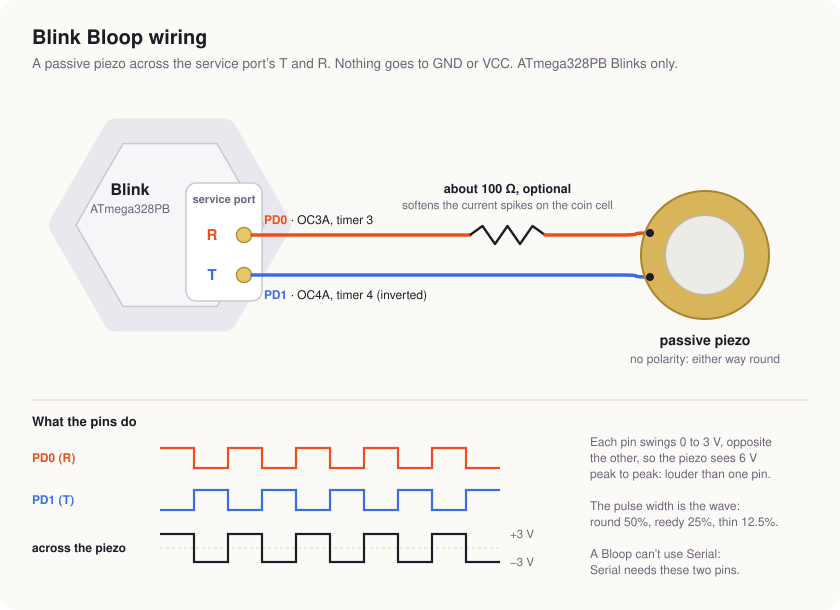

# Blink Bloop: a Blink with a speaker

A **Bloop** is a Blink with a small piezo speaker. It's a Blink in every other way: the same six faces, button, IR and blinklib. A sketch plays sound through a few new functions that work like the ones for light.

This document is the proposed API, how the playground simulates it, and how to make one from a Blink. The playground runs it, and uploads it to a Blink with a piezo as a beta board. The questions at the end need answers before the API is final.

## Design

**Sound is a state, like light.** `setColor(RED)` keeps the Blink red until something else changes it. `setNote(NOTE_E)` keeps the Bloop playing an E until something else changes it, and `setNote(QUIET)` stops it, as `OFF` turns a light off. There's no `tone(freq, duration)` that waits, for the same reason there's no `delay()`: `loop()` has to keep running. A melody is a Timer stepping through notes, just like an animation.

**One voice per Bloop.** A Bloop plays one note at a time. Three Bloops playing at once make a chord, so a group of Bloops is a band.

**A few names, and then anything.** Light has eight named colors, and `makeColorRGB()` for every other color. Sound has eight named notes, and `makeToneHz()` for any other frequency.

**Notes fit in a face value.** Named notes are small numbers (1 to 63), so a Blink can send one to a Bloop with `setValueSentOnFace()`. A Blink with no speaker can still be the keyboard, the conductor or the drum machine.

**Honest to a piezo.** A piezo plays a square wave well, low notes badly, and loudness hardly at all. So the sound choices are the ones a piezo can make: pulse widths that change the sound's color, and noise for drums. There's no volume control, and no sine or triangle wave.

## The API

| Function | What it does | Like |
|---|---|---|
| `setNote(Note n)` | Play `n` until something else is played. `setNote(QUIET)` stops. | `setColor()` |
| `playNote(Note n, word ms)` | Play `n` for `ms` milliseconds, then stop. Doesn't wait. | a Timer |
| `bool isNotePlaying()` | Is a note playing? Goes false when a `playNote()` runs out. | `Timer::isExpired()` |
| `setWave(byte w)` | How notes sound: `WAVE_ROUND` (the start), `WAVE_REEDY`, `WAVE_THIN` or `WAVE_NOISE`. Stays until changed. | |
| `Note makeToneHz(word hz)` | A tone at any frequency, in Hz (64 and up). | `makeColorRGB()` |
| `Note noteUp(Note n, byte steps)` | `n` raised by half steps. 12 is an octave. | `lighten()` |
| `Note noteDown(Note n, byte steps)` | `n` lowered by half steps. | `dim()` |
| `word noteHz(Note n)` | The frequency of `n`, in Hz. | |
| `byte isBloopBlink()` | 1 on a Bloop, 0 on a Blink without a speaker. | `isMAXblink()` |

`Note` is a 16-bit whole number (`uint16_t`).

The named notes are the C major scale from C5 (523 Hz) to C6 (1047 Hz). That's where a piezo sounds best; middle C is quieter and buzzier on one.

| Name | Value | Note | Hz |
|---|---|---|---|
| `QUIET` | 0 | no sound | |
| `NOTE_C` | 36 | C5 | 523 |
| `NOTE_D` | 38 | D5 | 587 |
| `NOTE_E` | 40 | E5 | 659 |
| `NOTE_F` | 41 | F5 | 698 |
| `NOTE_G` | 43 | G5 | 784 |
| `NOTE_A` | 45 | A5 | 880 |
| `NOTE_B` | 47 | B5 | 988 |
| `NOTE_HIGH_C` | 48 | C6 | 1047 |

Sharps and flats are `noteUp(NOTE_C, 1)`, and octaves are `noteUp(n, 12)` and `noteDown(n, 12)`.

### What a Note value means

A `Note` is either a step on the scale or a frequency:

- **0** is `QUIET`.
- **1 to 63** are half steps. Each step is one piano key, 12 to an octave. 33 is A4 (440 Hz), 36 is C5, 48 is C6, and 63 is D♯7 (2489 Hz). The number is the MIDI note number minus 36.
- **64 and up** are a frequency in Hz, made by `makeToneHz()`. Sound below 64 Hz is too low for a piezo, so nothing is lost.

`noteUp()` and `noteDown()` stay on the scale for half steps: they stop at 1 and 63, and `QUIET` stays quiet. For a frequency, they multiply or divide it by 2^(steps/12). They use whole-number math that a Blink can do the same way: a table of the 12 half-step ratios, out of 32768, then an octave shift.

### Waves

| Name | Value | Sound |
|---|---|---|
| `WAVE_ROUND` | 0 | A square wave (50% pulse): full and plain. The start. |
| `WAVE_REEDY` | 1 | A 25% pulse: brighter and buzzier, like a reed. |
| `WAVE_THIN` | 2 | A 12.5% pulse: thin and nasal, and a little quieter. |
| `WAVE_NOISE` | 3 | Noise: a hiss whose pitch follows the note. For drums, wind and surf. On a real Bloop, a rattle (see below). |

### When a Bloop is quiet

- **Startup.** A Bloop starts quiet with `WAVE_ROUND`, when powered up and when it gets a new game.
- **Sleep, game sharing, a crash.** It's quiet while asleep, while sharing a game, and when the sketch has stopped. It picks up its note again when it wakes.
- **A Blink with no speaker.** The sound functions do nothing there, except that `isNotePlaying()` still says what would be playing. A game for Bloops and plain Blinks can ask `isBloopBlink()`.

## Examples

A scale on one click:

```cpp
Timer beat;
byte step = 8;
const Note scale[] = { NOTE_C, NOTE_D, NOTE_E, NOTE_F, NOTE_G, NOTE_A, NOTE_B, NOTE_HIGH_C };

void loop() {
  if (buttonSingleClicked()) step = 0;
  if (step < 8 && beat.isExpired()) {
    playNote(scale[step], 180);
    step++;
    beat.set(200);
  }
  setColor(isNotePlaying() ? YELLOW : OFF);
}
```

A chord from neighbors: each Bloop plays a third above the one on its face 0.

```cpp
void loop() {
  Note mine = NOTE_C;
  if (!isValueReceivedOnFaceExpired(0)) mine = noteUp(getLastValueReceivedOnFace(0), 4);
  setValueSentOnAllFaces(mine);
  setNote(buttonDown() ? mine : QUIET);
}
```

## Blocks

The Sound drawer has **play note** (holds), **play note for ms**, **sound like** (the wave), **note up / down**, **tone Hz**, and **playing a note?** and **I have a speaker?**. The note block is a dropdown of the named notes and quiet, and it plugs into any number slot, so notes can go in variables and lists, and be sent to neighbors.

## In the playground

- **Which Blinks are Bloops.** Each Blink on the table is a Bloop or not. The speaker button under the table switches all of them, and <kbd>B</kbd> switches the one under the pointer. A sketch that plays sound turns every Blink into a Bloop if none is one. A Bloop has a speaker grille at its center. Its kind is saved with the layout, in share links and in arrangements.
- **Hearing it.** Each Bloop is a WebAudio voice: an oscillator with a pulse wave, or a noise source, through a shared compressor. Browsers only allow sound after a click, so the first click on the page turns sound on. The speaker button mutes it.
- **Seeing it.** A playing Bloop sends out rounded hexagon ripples, faster for higher notes and broken up for noise. The sound shows even with the sound muted.
- **Time.** Sound follows the simulator's time. Pausing stops it, and at 2× a 200 ms note lasts 100 ms. Pitch doesn't change with speed.
- **Clock drift.** A Bloop makes its pitch from its own clock, so a Bloop whose clock runs 1% fast plays 1% sharp. The simulator does the same, which is why a chord of Bloops shimmers a little. The clock drift slider makes it more or less.
- **Short notes.** The sound is updated once per screen frame (about 16 ms). A `playNote()` shorter than a frame still sounds, for its own length.
- **Real Bloops.** Upload to a Blink builds it for a Blink Bloop. Hardware-exact mode doesn't play sound yet, so a sketch that plays sound runs in the simulator.

## On a real Blink (beta)

A Bloop is a Blink with an ATmega328PB and a passive piezo soldered across its service port's **T** and **R**. Upload to a Blink, under Beta boards, has a **Blink Bloop** board for it. It refuses a 168PB, and it's picked for you when the sketch plays sound.



- **Wiring.** Just the piezo, either way round, from R to T. Nothing goes to GND or VCC. A resistor of about 100 Ω in series is optional: it softens the current spikes the piezo draws from the coin cell at each edge.
- **How it plays.** On the 328PB, R is PD0, which is also OC3A, and T is PD1, which is also OC4A. The BIOS uses timers 0, 1 and 2 for the LEDs and IR, and leaves timers 3 and 4 alone. Both run the same fast PWM, timer 4's inverted, so the piezo sees the battery's voltage one way and then the other: about 6 V peak to peak, twice what one pin gives. The pulse width is the wave. The timers count the 8 MHz clock from 123 Hz up, and an eighth of it below.
- **No interrupts.** The BIOS moves the interrupt vectors into its own section, and its table stops at vector 16 (timer 0 overflow). A game can't have an interrupt, so the timers make the sound with nothing running between passes of `loop()`. `playNote()` ends at the first pass after its time is up, a few milliseconds at most.
- **Noise.** An LFSR needs an interrupt, so on hardware `WAVE_NOISE` is a rattle instead of a hiss: each pass of `loop()` picks a new pitch between half and one and a half times the note's. The simulator plays a hiss. A BIOS that passed a timer 3 or 4 interrupt to the game would make real noise possible.
- **Quiet.** The Bloop's blinklib goes quiet before warm sleep, game sharing and a stack overflow, plays the note again after waking, and lets go of the timers before `setup()`, because a game downloaded over IR starts without a reset.
- **Serial.** `Serial.begin()` takes the same two pins, so a Bloop that uses Serial stays quiet.
- **The 168PB can't.** Its PD0 and PD1 have no timer outputs, the BIOS uses all three of its timers, and a game can't have an interrupt. A Bloop needs a 328PB.
- **blinklib.** The Bloop's blinklib is Move38's (SDK 1.3.0), with [bloop.cpp](../hardware/bloop/bloop.cpp) added, [bloop.h](../hardware/bloop/bloop.h) included from blinklib.h, and calls into it at six points in blinklib.cpp's run loop and warm sleep ([hardware/bloop/core.mjs](../hardware/bloop/core.mjs) makes the changes when the toolchain is built). The BIOS is a Blink328's. On other boards a sketch that plays sound doesn't build: their blinklib has no sound.
- **Not yet.** Hardware-exact mode runs Blinks without a speaker, so a sketch that plays sound runs in the simulator there. The emulated 328PB has timers 3 and 4, so it could play a Bloop's real output next.

### Open questions

1. Should the BIOS pass a timer 3 or 4 interrupt to the game? It would give real noise, and fades.
2. What's the piezo's real range? Measure loudness from 200 Hz to 8 kHz on the actual part, then choose the named octave and the lowest Hz `makeToneHz()` allows.
3. How much battery does a held note use? If it's a lot, a Bloop could go quiet after some time without a button press, as it goes to sleep after 10 minutes.
4. Is there a quiet mode for a classroom, a volume step, or a switch?
5. Should a long-held note fade like a plucked string? Narrowing the pulse over time would do it. That could be a wave (`WAVE_PLUCK`) or a separate setting.
6. Names: `NOTE_C` versus solfège (`DO RE MI`), and whether the named notes should be a pentatonic scale, which never sounds wrong.
7. Can a sketch tell when a note sounded? On some boards `millis()` jitters. A rhythm game might want a callback, or a note queue.

## A learning world

A seventh world for Light the Board, "Sound", could go: a button that beeps (`playNote`), a melody on a Timer, a song from a list, a chord from neighbors, and a rhythm machine, where a beat passes from Blink to Blink and each Bloop plays its note when the beat arrives.
